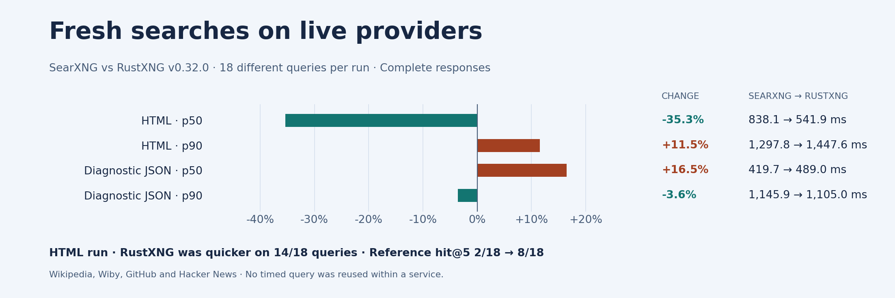
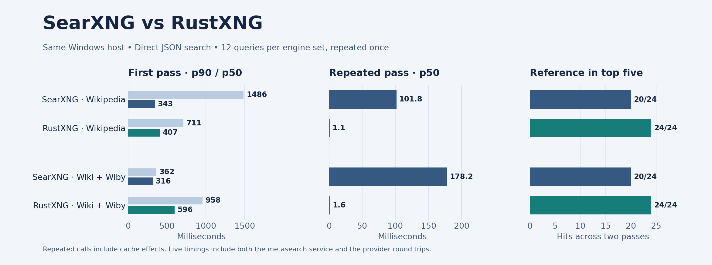
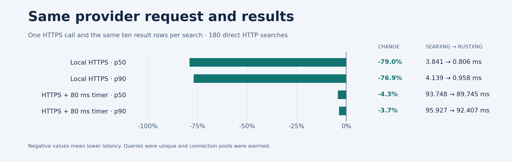

# RustXNG Research MCP

A small Rust MCP server that connects AI clients to a self-hosted RustXNG instance. RustXNG is a Rust rewrite of the Python [SearXNG](https://github.com/searxng/searxng) metasearch engine. Search the web for links and snippets, or ask RustXNG for the source text it can retrieve. The server runs over stdio and talks to RustXNG through its documented HTTP API.

[Architecture and troubleshooting](docs/architecture.md) · [SearXNG vs RustXNG benchmark](docs/searxng-vs-rustxng.md)

## SearXNG vs RustXNG

On 18 fresh queries across Wikipedia, Wiby, GitHub and Hacker News,
RustXNG v0.32.0 delivered the HTML response **35.3% sooner at the median**
(838 → 542 ms) and won **14 of 18** calls. Its HTML p90 was **11.5% longer**.
In a separate diagnostic JSON run it had a **16.5% longer median** and a
**3.6% shorter p90**. Both runs used live providers. [User-facing benchmark and raw records](docs/fresh-user-search.md)



In a follow-up HTML run, a newer RustXNG source build cut the release's
median by **14.4%** (520 → 445 ms) and p90 by **17.2%** (871 → 721 ms),
with the same **8/18** reference hits. Its median was **2.5% longer**
than SearXNG's in that run, and its p90 was **27.5% shorter**.
[Three-way comparison and build instructions](docs/fresh-user-search.md#a-newer-rustxng-build)

### Earlier Wikipedia and Wiby panel

| Direct HTTP search | RustXNG change vs SearXNG |
| --- | --- |
| First pass, Wikipedia | **18.8% longer** at p50 · **52.1% shorter** at p90 |
| First pass, Wikipedia + Wiby | **88.5% longer** at p50 · **164.4% longer** at p90 |
| Identical repeat, both engine sets | **98.9–99.1% shorter** at p50 · **98.7–98.8% shorter** at p90 |
| Expected article in the top five | **83.3% → 100%** per engine set · **+16.7 percentage points** |
| Median result rows | **1 → 10** for Wikipedia (+900%) · **12 → 21.5** for Wikipedia + Wiby (+79.2%) |



The live comparison covers 12 topics and 96 direct HTTP searches. Both
services received the same query text and engine names, with the
slowest engine accounting for 98.1–99.7% of request time at the median
in a follow-up run. Repeated searches include caching. [Full live results and raw measurements](docs/searxng-vs-rustxng.md)

With one identical HTTPS provider request and ten identical result rows
per search, RustXNG's median was **79.0% lower** on the local fixture
(3.841 → 0.806 ms) and **4.3% lower** with an 80 ms provider timer
(93.748 → 89.745 ms). [180-sample matched-work test and method](docs/architecture-latency.md#matched-work-on-the-same-provider)



[First-query tuning and durable cache](docs/rustxng-first-query.md) · [Separate MCP adapter and page retrieval benchmarks](docs/benchmarks.md)

## Quick start

Start [RustXNG](https://github.com/RustXNG/RustXNG) v0.32.0 or newer from its own release or source distribution.

```sh
rustxng --profile standard --bind 127.0.0.1 --port 29483
```

Build this client with Rust 1.89 or newer. On Windows, use a Developer PowerShell with the MSVC toolchain available.

```sh
cargo build --release --locked
cargo test --locked
```

Add the executable to your MCP client's local stdio configuration. Use the absolute path to `target/release/rustxng-research-mcp` and append `.exe` on Windows. The following entry goes in `opencode.json`.

```json
{
  "mcp": {
    "servers": {
      "rustxng-research": {
        "type": "local",
        "command": ["/absolute/path/to/rustxng-research-mcp"],
        "environment": { "RUSTXNG_URL": "http://127.0.0.1:29483" }
      }
    }
  }
}
```

The default endpoint is `http://127.0.0.1:29483`. `RUSTXNG_URL` can point to another RustXNG instance you operate.
See [OpenCode's local MCP configuration](https://opencode.ai/docs/mcp-servers/) for client options.

## Tools

| Tool | What it returns | Default limit |
| --- | --- | ---: |
| `rustxng_search` | Result links, titles, snippets and available engine status. | 10 |
| `rustxng_research` | Search results with page text and the per-page retrieval status reported by RustXNG. | 5 |

Each tool accepts `query`, `limit`, and optional `language` and `engines`. `engines` is a comma-separated list of engine IDs from your RustXNG profile. These arguments search for Tokio documentation in English.

```json
{"query":"Tokio task cancellation documentation","language":"en","limit":5}
```

This client makes one request to RustXNG per tool call. It asks for no credentials. An optional local SQLite cache can reuse recent link searches across restarts. [Cache settings](docs/rustxng-first-query.md#keeping-a-small-cache-on-ssd). Your RustXNG profile determines its external requests, page extraction capabilities, and cache policy. A result can have a snippet and a retrieval status even when the page text is unavailable.

RustXNG v0.32.0 requires direct connections for its page fetcher to validate destinations. If a search returns snippets but no page text, check the upstream server's own fetch and proxy configuration. Follow the settings required by your network. Text truncation and retrieval status are shown when RustXNG supplies them.

## Project status and license

This is an independent client for the RustXNG HTTP API. Install RustXNG separately under its own [AGPL-3.0-or-later license](https://github.com/RustXNG/RustXNG). This client's source is available under the [PolyForm Noncommercial License 1.0.0](LICENSE), subject to its terms. See [NOTICE](NOTICE) for attribution.

Maintained by [AndrewSnusoed5](https://github.com/AndrewSnusoed5). Stars, reproducible issue reports and pull requests are welcome.

## Support

Optional donations can be sent to the following wallet on **Solana mainnet**.

```text
CBBRkEL644LngYtDRkacVftVarrjfdg4NaBpUWbSJM5m
```

Use SOL, [native USDC](https://developers.circle.com/stablecoins/usdc-contract-addresses) or [USDT on Solana](https://tether.to/en/supported-protocols/). For an SPL token, use a sender wallet that supports creating the recipient's associated token account when needed. [View the wallet on Solana Explorer](https://explorer.solana.com/address/CBBRkEL644LngYtDRkacVftVarrjfdg4NaBpUWbSJM5m).
