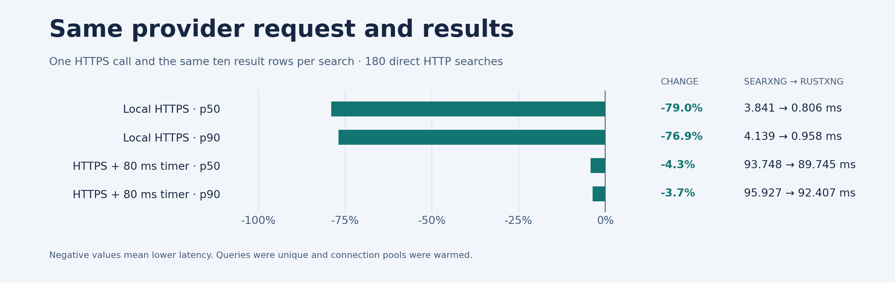

# Why first-pass search can be slower in RustXNG

The original live comparison sent the same query texts and engine names to
both metasearch services. The two Wikipedia adapters perform different work.
In the tested SearXNG revision, the Wikipedia adapter passes the query to
the exact-title REST page-summary endpoint and contributes at most one result
row. RustXNG v0.32.0 produced ten article candidates per query on this panel.
SearXNG returned zero Wikipedia rows for “Mars rover Curiosity” and “Voyager
1 spacecraft.” RustXNG found the expected articles. A difference in
end-to-end latency on this workload includes the provider calls and the
different result sets.
[SearXNG Wikipedia adapter](https://github.com/searxng/searxng/blob/c6ee3e9fd0235004a694e63720efc869bb1e3594/searx/engines/wikipedia.py)
· [Original live benchmark](searxng-vs-rustxng.md)

The SearXNG application ran in Python under Granian, an HTTP server written
in Rust. Its outbound transport used curl_cffi and libcurl. This setup
already uses native code for much of its HTTP work.
[Granian](https://github.com/emmett-framework/granian) · [curl_cffi](https://curl-cffi.readthedocs.io/en/latest/)

## Where the live requests waited

A follow-up pass recorded provider-adapter timings from SearXNG's
Server-Timing header and from RustXNG's detailed JSON. It used 12
topics per engine set and zero reported failures. These adapter timers
include the remote call and the engine's handling of its response.
The share and residual columns are medians of per-request calculations.

| Engines | Service | Whole request p50 | Slowest engine p50 | Slowest engine share | Residual p50 |
| --- | --- | ---: | ---: | ---: | ---: |
| Wikipedia | SearXNG | 119.34 ms | 116.98 ms | 98.1% | 2.26 ms |
| Wikipedia | RustXNG | 412.53 ms | 411.21 ms | 99.7% | 1.32 ms |
| Wikipedia + Wiby | SearXNG | 325.00 ms | 322.65 ms | 99.3% | 2.37 ms |
| Wikipedia + Wiby | RustXNG | 566.16 ms | 564.29 ms | 99.6% | 1.69 ms |

Relative to SearXNG in this follow-up, whole-request p50 was **245.7%
higher** for Wikipedia and **74.2% higher** for Wikipedia + Wiby.
The residual p50 outside the slowest engine was **41.3% lower**
and **28.9% lower**, respectively. The residual includes other
service work and HTTP handling on loopback.

The Wikipedia + Wiby phase followed Wikipedia alone. It could reuse
Wikipedia engine results, which happened on RustXNG. Provider timing can
vary across runs, as the SearXNG Wikipedia median did between the original
and follow-up panels. The timing split places the difference inside the
provider-adapter path on these live requests.
[48 live timing records](live-engine-timings.jsonl)

## Matched work on the same provider

Both services ran on the same Windows machine with the versions from the
original comparison. Each used its own Wiby JSON adapter, configured to
call the same local HTTPS fixture before each response. The fixture always
returned the same ten URLs, titles, and snippets for a given query. The
runner checked output equality and exactly one provider call per search.
Each measured query was new to the corresponding process. HTTP connection
pools had five warm-up pairs per condition.

| Provider timing | Calls per service | p50 SearXNG → RustXNG | p90 SearXNG → RustXNG |
| --- | ---: | ---: | ---: |
| Local HTTPS provider, no added wait | 60 | 3.841 → 0.806 ms (**−79.0%**) | 4.139 → 0.958 ms (**−76.9%**) |
| Same provider, 80 ms timer before response | 30 | 93.748 → 89.745 ms (**−4.3%**) | 95.927 → 92.407 ms (**−3.7%**) |

On the no-delay fixture, SearXNG's median time was **4.77×** the
RustXNG median. With the added provider wait, the end-to-end
difference was **4.003 ms** at p50. The operating-system timer made
the observed wait about 87–88 ms at p50.

The interval from the start of the fixture's response to the end of
JSON parsing includes local transport, provider response processing,
aggregation, and client handling. These times use the same SearXNG
baseline for the percentage.

| Provider timing | Interval p50 SearXNG → RustXNG | Interval p90 SearXNG → RustXNG |
| --- | ---: | ---: |
| Local HTTPS provider, no added wait | 2.491 → 0.445 ms (**−82.1%**) | 2.689 → 0.526 ms (**−80.4%**) |
| Same provider, 80 ms timer before response | 4.562 → 0.917 ms (**−79.9%**) | 4.949 → 0.977 ms (**−80.3%**) |

[180 matched-work samples](matched-provider-results.jsonl)

## Wiby pagination check

The first page is a small difference in request encoding. In otherwise
identical templates, SearXNG forwarded p=1 and RustXNG forwarded p=.
Both forwarded p=2 and p=3 identically. Three small requests to Wiby's
live JSON endpoint returned the same ordered URLs for an empty p and
p=1 on “retro computing,” “unix history,” and “geocities.” This probe
gives no evidence of a page-one regression for those queries.
[Local pagination trace](pagination-probe-results.jsonl)

## Reproduce the matched test

Use the same SearXNG checkout and Python environment as in the
[original benchmark](searxng-vs-rustxng.md). Install OpenSSL on the
benchmark machine and expose its command on PATH. The runner creates a
temporary loopback certificate authority trusted only by the temporary
search processes for the fixture. It launches both services and the
provider locally.

~~~sh
node bench/matched-provider.mjs /absolute/path/to/rustxng /path/to/searxng/.venv/bin/python /path/to/searxng > docs/matched-provider-results.jsonl
node bench/matched-provider.mjs /absolute/path/to/rustxng /path/to/searxng/.venv/bin/python /path/to/searxng --pagination > docs/pagination-probe-results.jsonl
~~~

For the live timing pass, start the services from the original benchmark,
set BENCH_ENGINE_TRIALS=1, and pass --timings to bench/compare-engines.mjs.
