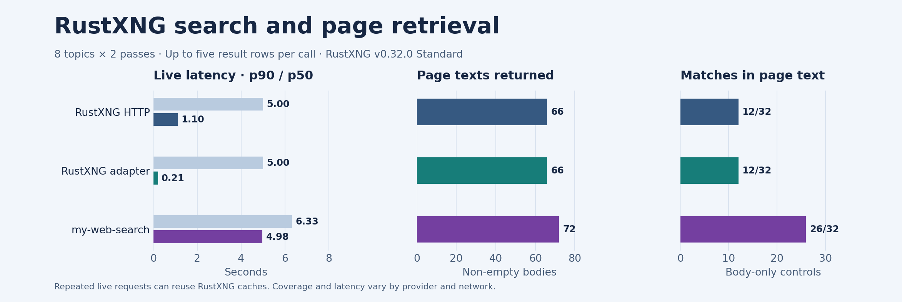
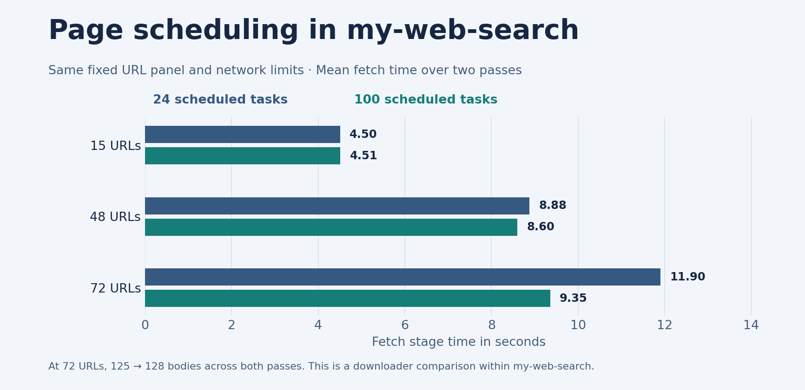

# Benchmarks

Measured on Windows on 22 November 2026. RustXNG ran locally at v0.32.0
with its Standard profile. The public adapter was built from commit 3375e31.
The my-web-search executable was a native development build from the same
day with its own retrieval pipeline and a warmed local BGE service.

## Live retrieval

| Route | p50 | p90 | Page bodies | Body controls | Body characters | Errors |
| --- | ---: | ---: | ---: | ---: | ---: | ---: |
| RustXNG HTTP | 1.105 s | 5.004 s | 66/80 | 12/32 | 424,426 | 0/16 |
| RustXNG through this MCP adapter | 0.211 s | 5.004 s | 66/80 | 12/32 | 424,426 | 0/16 |
| Native my-web-search with the same RustXNG | 4.976 s | 6.328 s | 72/80 | 26/32 | 354,709 | 0/16 |

Each route received eight identical query texts twice in rotated order, with
the same language and up to five result rows per call. The upstream page
limit was 8,000 characters, and the native tool used bodyChars=8000. The
native call used web_search with five body slots. Its own page and result
disk caches were disabled, its result RAM cache was disabled, and no optional
search API keys were passed. The two RustXNG routes shared upstream caches.

The table includes warm calls. The first raw-content request on each of the
eight topics, pooled across HTTP and the adapter, had a median of **1.880 s**
and a p90 of **10.634 s**. The native pipeline found 14 additional body
control matches across two passes and returned six more non-empty bodies.
Its total character count was lower. A control is a preset text pattern
matched within one downloaded body, excluding snippets and titles. This
panel measures retrieval on the chosen examples. The workload and its
controls are in [compare.mjs](../bench/compare.mjs).

## Adapter cost on a fixed response

The loopback fixture returned five identical result records and the same
body text on every call. Both clients parsed the response, and the runner
checked the complete result records for equality. After five warm-up pairs,
it timed 60 calls per route, alternating the order.

| Route | p50 | p90 |
| --- | ---: | ---: |
| HTTP client | 0.464 ms | 0.750 ms |
| MCP adapter | 0.494 ms | 0.638 ms |

The median difference was **0.030 ms** in this setup, including the client
implementations and their JSON handling. Use this controlled test for adapter
cost. The live p50 values include different cache states.

## Older and newer page scheduling in my-web-search

| Same URLs per call | 24 scheduled tasks | 100 scheduled tasks | Bodies across both passes |
| --- | ---: | ---: | ---: |
| 15 | 4.505 s | 4.509 s | 27 → 28 of 30 |
| 48 | 8.877 s | 8.598 s | 88 → 90 of 96 |
| 72 | 11.899 s | 9.354 s | 125 → 128 of 144 |

This earlier test fed the same URL prefixes into analyze_pages in one
my-web-search build. It changed MWS_RUST_PAGE_TASKS from 24 to 100,
left the network limits and fetch budgets in place, and reversed the
order on the second pass. The table reports the mean of the two fetch
stage timings. At 72 URLs the stage took about **21% less time**.
[Numeric results](fetch-scheduling.json)

This is a comparison of schedulers inside my-web-search. The live table
above compares routes on RustXNG v0.32.0. The Windows asset for the older
upstream v0.31.2 was unavailable during this run, so an upstream release
comparison remains open. [Upstream release notes](https://github.com/sahenjp/RustXNG/releases/tag/v0.31.2)

## Reproduce

Build the adapter with cargo build --release --locked. Start a separate
local RustXNG instance with the benchmark configuration and a direct
outbound connection, where supported by your network. Run the following
from this repository. Append .exe to the executable paths on Windows.

~~~sh
rustxng --profile standard --config bench/rustxng.toml --bind 127.0.0.1 --port 29483
~~~

In a second terminal, run Node.js 22 or newer.

~~~sh
node bench/compare.mjs http://127.0.0.1:29483 ./target/release/rustxng-research-mcp > docs/benchmark-results.jsonl
~~~

An optional third argument is the absolute path to a my-web-search-rust
executable. Warm its local BGE service on port 8891 before measuring that
route. For an upstream version comparison, run the older release on a
second port with the same profile and limits and set RUSTXNG_OLD_URL.
Results vary as providers and network conditions change.

The [committed run](benchmark-results.jsonl) contains counters and timings.
Regenerate the PNGs with Python and Matplotlib.

~~~sh
python bench/plot.py
~~~
