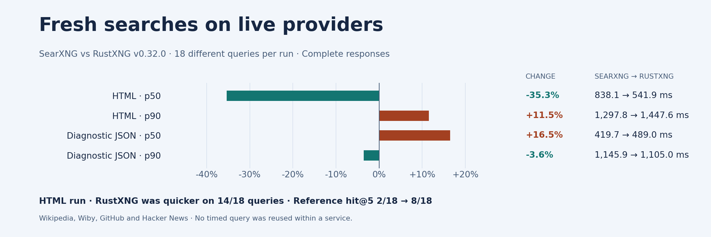
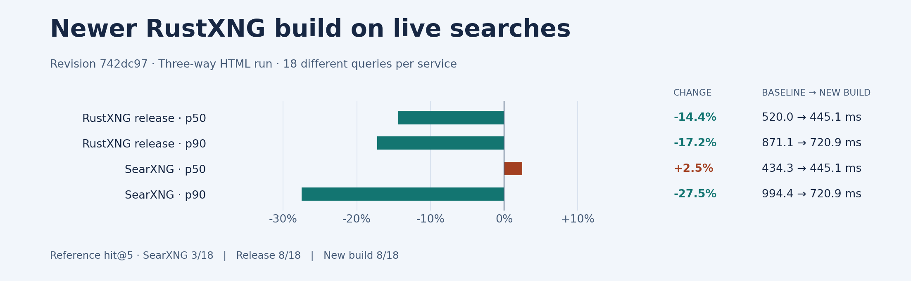

# How fast is a new search?

This benchmark starts with a running search service. A user submits a
search phrase the service has not seen, then waits for the complete HTML
response. The timed interval ends once the response HTML is downloaded
over loopback. Browser layout, static assets and clicks to source pages
are outside this interval. There are no repeated searches within a run.

## Live result

On 22 November 2026, three isolated instances ran on one Windows 11
host. SearXNG 2026.11.21+c6ee3e9 used Python 3.12.1 and Granian 2.8.8
with one worker. RustXNG v0.32.0 used Standard with four explicitly
selected engines. All arms used Wikipedia, Wiby, GitHub and Hacker News.
The 18 English and Russian queries cover information lookup, sources,
software and web history. Each service saw each query once, and the
order rotated across topics. The runner paced topic rounds at eight
seconds, with at least 1.1 seconds between starts inside each round.
The machines could reuse outbound connections. External provider caches
were outside the experiment's control. The Windows SearXNG entry point
normalizes template path separators for HTML rendering.

| Run and service | p50 | p90 | Reference in top five | Median rows | Empty |
| --- | ---: | ---: | ---: | ---: | ---: |
| HTML, SearXNG | 838.10 ms | 1,297.76 ms | 2/18 | 11 | 4/18 |
| HTML, RustXNG | 541.92 ms (**−35.3%**) | 1,447.59 ms (**+11.5%**) | 8/18 | 17 | 0/18 |
| Diagnostic JSON, SearXNG | 419.70 ms | 1,145.94 ms | 4/18 | 11 | 3/18 |
| Diagnostic JSON, RustXNG | 489.00 ms (**+16.5%**) | 1,104.97 ms (**−3.6%**) | 8/18 | 17 | 0/18 |

RustXNG had the shorter response on 14 of 18 HTML queries and 7 of 18
diagnostic JSON queries. The tests ran in separate time windows with
fresh processes, so differences between rows also include provider
and network variation. The HTML run measures server response to the
browser request and the JSON run exposes engine timers. Percentages
use the SearXNG time for the same run as baseline. p50 is the median.
p90 is the nearest-rank 90th percentile. Hit@5 checks a reference URL
or a small set of accepted URL patterns selected in advance.
[HTML measurements](fresh-user-search-results.jsonl) · [Diagnostic JSON measurements](fresh-user-search-timings.jsonl)

## Where the time goes

On the RustXNG diagnostic run, the longest engine timer took a median
**99.6%** of the measured request. Wikipedia was slowest in **9/18**
calls, GitHub in **6/18**, Hacker News in **2/18**, and Wiby in **1/18**.
The GitHub timer hit **1,331 ms** in one call. Wikipedia hit **1,103 ms**
in another. Parallel fetches make the slowest provider matter. These
timers include the remote request and engine-side processing.
[Google Research, The Tail at Scale](https://research.google/pubs/the-tail-at-scale/)

The two Wikipedia implementations make different requests. SearXNG
looks up the entered title through its page-summary route. RustXNG
asks MediaWiki to search and can return ten candidates in one call.
The following test used curl_cffi with a direct connection pool and
60 requests, paced at 1.1 seconds or more. It used the 12 reference
topics from the earlier Wikipedia benchmark. The two Action API user
agents identified the software by name, version, and project URL.

| Wikipedia endpoint and User-Agent | p50 | p90 | Reference in top five | Median rows |
| --- | ---: | ---: | ---: | ---: |
| Exact-title summary | 197.56 ms | 694.54 ms | 10/12 | 1 |
| Action full-text search, RustXNG identity | 393.75 ms | 542.51 ms | 12/12 | 10 |
| Action full-text search, this project's identity | 371.06 ms | 469.01 ms | 12/12 | 10 |
| REST full-text search | 408.30 ms | 476.79 ms | 12/12 | 10 |
| REST title autocomplete | 286.94 ms | 339.39 ms | 12/12 | 3 |

The two 404 responses were summary lookups. There were zero 429 or 503
responses, zero Retry-After headers, and zero Action API errors. Both
identities won some pairs. The median paired advantage followed which
identity went first, so the test supplies no reproducible User-Agent
speedup. It provides no evidence that Wikimedia throttling explains
these timings. Title autocomplete was quicker and returned fewer
candidates. The first connection to each language edition reached TLS
readiness after 272 ms and 325 ms respectively. The other 58 calls
reused a connection. Neither network setup nor the provider's work
runs faster simply because the metasearch server was compiled.
[Provider measurements](wiki-provider-results.jsonl) · [Wikimedia rate limits](https://www.mediawiki.org/wiki/Wikimedia_APIs/Rate_limits) · [MediaWiki REST search](https://www.mediawiki.org/wiki/API:REST_API/Reference#Search_pages) · [Released RustXNG Wikipedia adapter](https://github.com/TKY-27/RustXNG/blob/0aa36b3/src/engines/wikipedia.rs)

## Socket reuse and configuration

The experimental RustXNG instance with keepalive_expiry set to 30
seconds returned HTML at **458.13 ms p50 / 739.44 ms p90** and diagnostic
JSON at **444.91 ms p50 / 1,033.99 ms p90**. Both instances reused the
same provider socket after an eight-second pause in a controlled HTTPS
fixture. The released Rust code defines keepalive_expiry in settings
without wiring it into the reqwest client builder. The live spread
between instances cannot be attributed to that setting.
[Socket fixture records](provider-idle-results.jsonl) · [Released client builder](https://github.com/TKY-27/RustXNG/blob/0aa36b3/src/network.rs)

## A newer RustXNG build

The post-release RustXNG revision 742dc97 includes a change to parallel
search. Once results reach a minimum count, it allows the slow
providers a bounded grace period. It also overlaps upstream work in
some search paths. The candidate includes changes to result merging
and ranking, so this test measures the whole build. The version string
still says 0.32.0.
[Revision tested](https://github.com/TKY-27/RustXNG/commit/742dc9742b8cd0af97a946f58e50ffe350ae032c) · [Grace-window implementation](https://github.com/TKY-27/RustXNG/commit/c873c36ebd8c18d500dd4e07c7fe74cfad9ba61f)

The same 18 HTML queries ran on fresh instances of all three services
in one round-robin test.

| Service | HTML p50 | HTML p90 | Reference in top five | Median rows | Empty |
| --- | ---: | ---: | ---: | ---: | ---: |
| SearXNG | 434.34 ms | 994.37 ms | 3/18 | 11 | 3/18 |
| RustXNG v0.32.0 release | 519.97 ms | 871.15 ms | 8/18 | 17 | 0/18 |
| RustXNG 742dc97, source build | 445.14 ms | 720.91 ms | 8/18 | 17 | 0/18 |

The newer build beat the release on **14/18** requests. Its median fell
by **14.4%** and p90 fell by **17.2%**. The same eight references kept
their rankings in the top five. One query returned 20 rows where the
release returned 21. All other row counts matched. Against SearXNG
in this run, the newer RustXNG median was **2.5% longer**, and its p90
was **27.5% shorter**. It beat SearXNG on **9/18** individual requests.
[All 54 records from the candidate run](fresh-user-candidate-results.jsonl)

A local index is another way to shorten the first search of an unseen
phrase over a known collection. The index answers over documents that
are already on disk. Its coverage depends on the collection. Search
engines that still query the web remain subject to remote latency.
[RustXNG local indexing documentation](https://github.com/TKY-27/RustXNG/blob/742dc9742b8cd0af97a946f58e50ffe350ae032c/docs/LOCAL-INDEX.md)

## Reproduce

The live runner creates private loopback instances and leaves the
installed services and configuration alone. Use a SearXNG checkout with
its dependencies and Granian installed. The Wikimedia probe uses the
same curl_cffi package available in that environment. Use Python 3.12
for the tested SearXNG revision. OpenSSL on PATH is required for the
local HTTPS fixture.

~~~sh
node bench/fresh-user-search.mjs /path/to/rustxng /path/to/python /path/to/searxng html > docs/fresh-user-search-results.jsonl
node bench/fresh-user-search.mjs /path/to/rustxng /path/to/python /path/to/searxng json > docs/fresh-user-search-timings.jsonl
/path/to/python bench/wiki-provider.py > docs/wiki-provider-results.jsonl
BENCH_RUST_KEEPALIVE_SECONDS=5 node bench/matched-provider.mjs /path/to/rustxng /path/to/python /path/to/searxng --idle > docs/provider-idle-results.jsonl
BENCH_RUST_KEEPALIVE_SECONDS=30 node bench/matched-provider.mjs /path/to/rustxng /path/to/python /path/to/searxng --idle >> docs/provider-idle-results.jsonl
~~~

For the candidate comparison, build the pinned RustXNG source revision
in a separate directory with Cargo and the platform's build tools.
Pass the built binary as the last argument.

~~~sh
git clone https://github.com/TKY-27/RustXNG.git
git -C RustXNG checkout --detach 742dc9742b8cd0af97a946f58e50ffe350ae032c
cargo build --manifest-path RustXNG/Cargo.toml --release --locked --bin rustxng
node bench/fresh-user-search.mjs /path/to/rustxng /path/to/python /path/to/searxng html ./RustXNG/target/release/rustxng > docs/fresh-user-candidate-results.jsonl
python bench/plot.py
~~~
