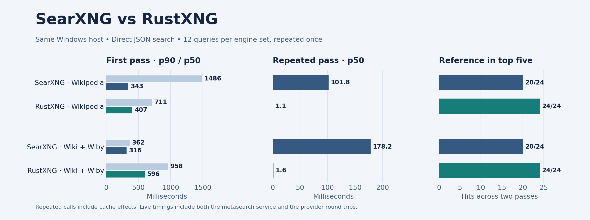

# SearXNG vs RustXNG

RustXNG is a Rust rewrite of the Python SearXNG metasearch engine. This
benchmark calls each service's JSON search endpoint directly. The test
uses shared engine names and the same queries, languages, and host.
[Upstream RustXNG](https://github.com/RustXNG/RustXNG) · [SearXNG Search API](https://docs.searxng.org/dev/search_api.html)

For the end-to-end HTML test with no repeated searches and a broader
provider mix, see [How fast is a new search?](fresh-user-search.md).

## Live search latency

Times are SearXNG → RustXNG. The percentage is the change from the
SearXNG time, calculated from the unrounded statistics. Negative
values mean shorter latency. Each table row is based on 12 calls per
service. p50 is the median and p90 uses the nearest rank.

| Engines | Pass | p50 and change | p90 and change |
| --- | --- | ---: | ---: |
| Wikipedia | First | 342.70 → 407.15 ms (**+18.8%**) | 1,486.15 → 711.27 ms (**−52.1%**) |
| Wikipedia + Wiby | First | 316.36 → 596.46 ms (**+88.5%**) | 362.44 → 958.44 ms (**+164.4%**) |
| Wikipedia | Repeat | 101.85 → 1.13 ms (**−98.9%**) | 197.22 → 2.51 ms (**−98.7%**) |
| Wikipedia + Wiby | Repeat | 178.23 → 1.64 ms (**−99.1%**) | 189.09 → 2.32 ms (**−98.8%**) |

On identical repeats, the SearXNG median was 90.1× the RustXNG median
with Wikipedia and 108.7× with Wikipedia + Wiby. The cache configuration
and its effect are part of this measurement. [All 96 numeric records](engine-benchmark-results.jsonl)

## Retrieval

| Engines | Reference in top five | Hit-rate change | Median number of result rows |
| --- | ---: | ---: | ---: |
| Wikipedia | 20/24 → 24/24 (83.3% → 100%) | +16.7 pp (+20.0% relative) | 1 → 10 (+900%) |
| Wikipedia + Wiby | 20/24 → 24/24 (83.3% → 100%) | +16.7 pp (+20.0% relative) | 12 → 21.5 (+79.2%) |

Each service saw 12 distinct topics in each pass. RustXNG put the
expected article in the top five for all 12 each time. SearXNG did so
for 10 each time and missed “Mars rover Curiosity” and “Voyager 1
spacecraft.” Both services reported zero HTTP or engine failures.
The top-five measure scores one chosen Wikipedia reference per topic.
Result row counts include every row returned by the search endpoint.

With the same HTTPS provider request and ten identical result rows,
the median fell from 3.841 to 0.806 ms (**−79.0%**) on the local
fixture. With an 80 ms provider timer it fell from 93.748 to 89.745 ms
(**−4.3%**). [Matched-work chart, p90 and separate provider timings](architecture-latency.md)

## Setup and scope

- 22 November 2026, Windows 11, loopback HTTP and live upstream providers.
- SearXNG 2026.11.21+c6ee3e9, Python 3.12.1, Granian 2.8.8, one
  worker and the [benchmark settings](../bench/searxng.yml). Wikipedia
  list output was enabled for top-five scoring. Valkey was off. A small
  Windows import shim supplied the Unix pwd module stub for the unused
  Valkey error-logging path. The search implementation came from the
  upstream checkout.
- RustXNG v0.32.0, native Windows release, Standard profile. The
  request restricted RustXNG to the named engines with strict_engines.
- Twelve English and Russian queries per engine set. Both servers received
  each query twice, with order alternated across topics and reversed on
  the repeat. The first pass used each query expression once for the
  specified engine set. The second engine set ran after the first, so
  provider-level reuse was possible across sets.
- Latency includes HTTP and reading the complete JSON response. p90 is
  the nearest-rank percentile. Top-five hit counts use a Wikipedia URL
  selected in advance for each query. Median results counts the complete
  response list; the hit metric uses its first five rows.

The adapters can query providers differently, even with the same engine
names. For example, SearXNG's Wikipedia adapter uses a page-summary
lookup. This panel measures the service users get with these settings,
including its provider calls and caching. The workload emphasizes
Wikipedia references and has 12 distinct topics. [SearXNG Wikipedia implementation](https://github.com/searxng/searxng/blob/c6ee3e9fd0235004a694e63720efc869bb1e3594/searx/engines/wikipedia.py)

## Reproduce

Run both services bound to loopback on the same host. Start SearXNG using
the repository's benchmark settings and enable the JSON search format.
On Linux, with SearXNG dependencies available, a Granian command is:

~~~sh
SEARXNG_SETTINGS_PATH=/absolute/path/to/rustxng-research-mcp/bench/searxng.yml \
  granian --interface wsgi --host 127.0.0.1 --port 18888 --workers 1 searx.webapp:app
~~~

The Windows run copied [searxng_windows.py](../bench/searxng_windows.py)
into the isolated SearXNG checkout as benchmark_wsgi.py. Install
requirements.txt and requirements-server.txt in a virtual environment,
set the same settings path, and use benchmark_wsgi:app as the Granian
target. Use a dedicated loopback benchmark instance with no
Valkey URL.

~~~sh
rustxng --profile standard --bind 127.0.0.1 --port 29483
node bench/compare-engines.mjs http://127.0.0.1:18888 http://127.0.0.1:29483 > docs/engine-benchmark-results.jsonl
python bench/plot.py
~~~

See [Adapter and downloader benchmarks](benchmarks.md) for the separate
MCP and page-retrieval measurements.
